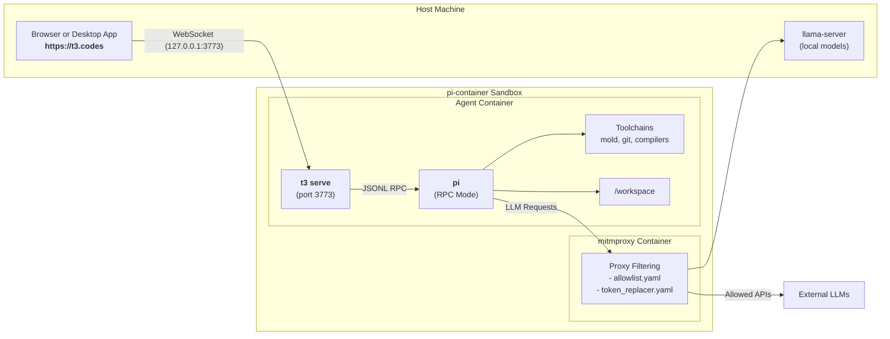

# T3 Code Integration

**T3 Code** ([t3.codes](https://t3.codes)) is an open-source, local-first control panel and graphical interface (desktop, web, and mobile) for AI coding agents. It provides a visual workspace with multi-threading, interactive diff reviews, branch management, and model reasoning visualizations.

T3 Code features first-class native support for the **Pi coding agent** (`@earendil-works/pi-coding-agent`), driving Pi via its structured JSONL RPC interface.

`pi-container` supports running T3 Code directly inside the isolated agent container, allowing you to use the **https://t3.codes** web interface (or the desktop/mobile apps) while retaining complete network egress inspection, token substitution, and sandbox isolation.

---

## Architecture Overview



### Key Principles

- **In-Container Execution**: The T3 Code server process (`t3 serve`) runs inside the agent container alongside Pi. It directly spawns `/usr/local/bin/pi` inside `/workspace`.
- **Inbound Host Forwarding**: Host port `3773` is published to the agent container (`127.0.0.1:3773`), allowing your host browser at `https://t3.codes` to establish a local WebSocket connection (`ws://127.0.0.1:3773`).
- **Proxy Egress & Token Replacement**: All outbound API calls from Pi or T3 Code traverse the `pi-coding-agent-proxy`. Unapproved network traffic is blocked, and dummy provider tokens are swapped with real credentials on the wire.
- **Dynamic Model Discovery**: T3 Code queries Pi's RPC endpoint, which dynamically loads model definitions from `/home/pi/.pi/agent/models.json` (including local `llama-server` endpoints).

---

## Quickstart

### 1. Enable the T3 Toolchain

Add `"t3"` to your `tools.include` list in `.pi-container/config.yaml`:

```yaml
tools:
  include:
    - "t3"
```

*(Alternatively, you can install the CLI dynamically in `.pi-container/dependencies/root/commands.sh` via `npm install -g t3` or `curl -fsSL https://t3.codes/install.sh | sh`).*

### 2. Launch in T3 Mode

Run the container launcher with the `--t3` flag:

```bash
./run.sh --t3
```

The launcher will:
1. Verify host port `3773` is free and forward `127.0.0.1:3773` to the agent container.
2. Launch `t3 serve --host 0.0.0.0 --port 3773`.
3. Output the T3 pairing URL:
    ```text
    ==================================================================
      Starting T3 Code server for Pi inside pi-container...
      Web UI: https://t3.codes
    ==================================================================
    Listening on http://0.0.0.0:3773
    Pairing URL: http://localhost:3773/pair#token=abcdef123456...
    ```

### 3. Connect from Your Browser

1. Click the pairing link from your terminal or open [https://t3.codes](https://t3.codes).
2. T3 Code connects to your local container instance via WebSocket.
3. Select any configured model from the model picker and start prompt sessions.

---

## Configuration Reference

### Agent Configuration (`config.yaml`)

You can set T3 mode as the default or configure custom port mappings in `.pi-container/config.yaml`:

```yaml
agent:
    # Execution mode: "cli" (default interactive terminal) or "t3" (headless server)
    mode: t3

    # Inbound host ports published directly from the agent container
    ports:
        # expose: localhost (127.0.0.1 only) or lan (0.0.0.0)
        expose: localhost
        publish:
            - 3773              # host 3773 -> container 3773
            - "13773:3773"      # custom host port 13773 -> container 3773
```

### Host Advertising & LAN Elevation

When T3 Code runs inside a container, `t3 serve` must bind to `--host 0.0.0.0` so forwarded traffic from the host (`-p 127.0.0.1:3773:3773` or `0.0.0.0:3773:3773`) is accepted. By default, T3 Code inspects container network interfaces and would advertise the internal bridge IP (e.g. `10.89.0.2`), which is unreachable from host browsers.

`pi-container` includes an automated network shim (`t3-advertise-host.cjs`) along with explicit CLI configuration knobs for advertised addresses and network exposure:

- **Advertised Host / Pairing URL**:
    - **Default (`localhost`)**: The pairing link and connection URL display `http://localhost:3773/pair#token=...` for local host browser use.
    - **External Host IP (`external`)**: To advertise the host machine's primary outbound IPv4 address (e.g. `192.168.1.100`), pass `--t3-external-ip` (or `--t3-advertise-host external`) on the CLI.
    - **Custom Host / Override**: Pass an explicit IP or hostname via `--t3-advertise-host <host>`:
        ```bash
        ./run.sh --t3 --t3-advertise-host 192.168.1.100
        ```
    - **Secure Tunnels**: For internet and mobile access, use automated tunnels via `--t3-tunnel <tailscale|cloudflare>` which automatically configure the advertised host and public HTTPS URL without touching `config.yaml`.
- **LAN Elevation (`agent.ports.expose`)**:
    - **Default (`localhost`)**: Port `3773` is published exclusively on `127.0.0.1:3773:3773`.
    - **LAN Access (`lan`)**: To allow pairing and connection from other devices on your local network (e.g. phone, tablet, or another machine), explicitly set `agent.ports.expose: lan` in `config.yaml` or pass `--t3-lan` on the CLI.
    - **Security Note**: Advertising an external IP without enabling LAN elevation will log a warning, as inbound connections from outside the host machine will be refused by the `127.0.0.1` bind. (This warning is automatically suppressed when a secure tunnel or `--t3-public-url` is active).


### Agent Specialization (Pi Exclusivity)

By default, upstream T3 Code ships with generic drivers enabled (such as `codex` and `claudeAgent`), while disabling Pi. Inside `pi-container`, T3 Code is strictly specialized for the Pi agent:

1. **Enterprise Policy Enforcement (`/etc/t3code/policy.json`)**:
    - The agent container bakes an administrative policy with `limits.providers.allowedDrivers: ["pi"]`.
    - Other drivers (`codex`, `claudeAgent`, `cursor`, `grok`) are permanently disallowed by policy and cannot be scheduled or started.
2. **Pre-Seeded User Settings (`userdata/settings.json`)**:
    - On server startup, `entrypoint.sh` seeds `/home/pi/.pi/agent/t3/userdata/settings.json`.
    - Pi is marked as enabled, alternative drivers are disabled, and the default model instance is set to `pi`.
3. **Persistent Base Directory (`--base-dir /home/pi/.pi/agent/t3`)**:
    - Because `/home/pi/.pi/agent` is mounted from the host project's `.pi-container/` directory, all projects, threads, and diff reviews persist across container restarts.


### Source Control Provider Toolchains

T3 Code includes integrated PR review, issue tracking, and repository operations for 6 Git hosting providers. You can enable their matching CLI tools in `tools.include`:

| Provider | Mechanism | Optional Tool | Description |
| :--- | :--- | :--- | :--- |
| **GitHub** | CLI (`gh`) | `gh` | Official GitHub CLI for pull requests and repo discovery. |
| **GitLab** | CLI (`glab`) | `glab` | Official GitLab CLI for merge requests and issue tracking. |
| **Forgejo / Gitea** | CLI (`tea`, `fj`) | `tea` | Official Gitea/Forgejo CLI. |
| **Azure DevOps** | CLI (`az`) | `az` | Azure CLI with pre-installed `azure-devops` extension. |
| **GitCafe** | CLI (`cafe`) | `cafe` | Official GitCafe CLI bundled with standalone Bun runtime. |
| **Bitbucket** | Direct API | *(none needed)* | T3 Code calls `api.bitbucket.org/2.0` natively via API token. |

To enable specific source control CLIs in your workspace, declare them in `.pi-container/config.yaml`:

```yaml
tools:
  include:
    - t3
    - gh
    - glab
    - tea
    - az
    - cafe
```


### Git Operations & Remote Rewriting

T3 Code periodically inspects local git branches and checks upstream remotes in the background (`branchPullRequest.remotes`, `fetchRemoteForStatus`). By default, `pi-container` automatically optimizes Git operations inside `/workspace`:

- **Safe Directory (`git.safe_directory: true`)**: Permitted by default to ensure Git commands run cleanly despite UID differences between the host filesystem and the container unprivileged user.
- **SSH-to-HTTPS Rewrites (`git.rewrite_ssh_to_https: true`)**: Transparently redirects `git@github.com:...` and other SSH remotes to `https://github.com/...`, allowing background status fetches to egress through the proxy without copying host SSH keys into the sandbox.


### Source Control Authentication & Token Forwarding

T3 Code background PR inspection and Git operations across all 6 providers require authentication tokens to query PR lists (`gh pr list`, etc.) and authenticate private HTTPS remotes.

`pi-container` resolves tokens securely and exclusively from the host OS keyring (or host CLI sessions), strictly rejecting `.env` files and host environment variables to prevent credential leakage:

```yaml
source_control:
    # Forward resolved provider tokens into the container. Default: false.
    enabled: false

    # Automatically query host CLI sessions (e.g. host `gh auth token`). Default: false.
    auto_detect_host_cli: false

    # Configure Git credential helpers (e.g. `gh auth setup-git`). Default: true.
    setup_git_credentials: true

    # Provider overrides or specific tokens.
    providers: {}
```

#### Saving Provider Tokens in OS Keyring

The recommended method to supply tokens is the secure OS keyring via `uv run keyring set pi-container <VAR>`:
- **GitHub**: `uv run keyring set pi-container GH_TOKEN`
- **GitLab**: `uv run keyring set pi-container GITLAB_TOKEN`
- **Forgejo / Gitea**: `uv run keyring set pi-container GITEA_TOKEN`
- **Azure DevOps**: `uv run keyring set pi-container AZURE_DEVOPS_EXT_PAT`
- **Bitbucket**: `uv run keyring set pi-container BITBUCKET_TOKEN`
- **GitCafe**: `uv run keyring set pi-container GITCAFE_TOKEN`

You can also configure custom keyring variable names per workspace (e.g. `keyring_var: PI_CONTAINER_T3_GH_TOKEN`), allowing multiple distinct tokens per provider across projects instead of a single global token:

```yaml
source_control:
    enabled: true
    providers:
        github:
            keyring_var: PI_CONTAINER_T3_GH_TOKEN
```

When tokens are present and `setup_git_credentials: true`, `entrypoint.sh` automatically runs `gh auth setup-git` and `glab auth setup-git` inside the container so Git HTTPS operations succeed without password prompts.


### Network Allowlist (`allowlist.yaml`)

Ensure upstream rules for T3 Code and your desired source control hosts are present in `.pi-container/allowlist.yaml`:

```yaml
    # T3 Code (t3.codes) web app and release endpoints
    - name: "t3-codes-allow"
      mode: "allow"
      hostnames:
        - "t3.codes"
        - "*.t3.codes"
        - "ping.gg"
        - "*.ping.gg"
      ip_ranges: []

    # Source control providers supported by T3 Code
    - name: "gitlab-source-control-allow"
      mode: "allow"
      hostnames:
        - "gitlab.com"
        - "*.gitlab.com"
      ip_ranges: []

    - name: "forgejo-gitea-source-control-allow"
      mode: "allow"
      hostnames:
        - "codeberg.org"
        - "*.codeberg.org"
        - "gitea.com"
        - "*.gitea.com"
        - "forgejo.org"
        - "*.forgejo.org"
      ip_ranges: []

    - name: "bitbucket-source-control-allow"
      mode: "allow"
      hostnames:
        - "bitbucket.org"
        - "*.bitbucket.org"
        - "api.bitbucket.org"
        - "auth.atlassian.com"
        - "id.atlassian.com"
        - "*.atlassian.com"
      ip_ranges: []

    - name: "azure-devops-source-control-allow"
      mode: "allow"
      hostnames:
        - "dev.azure.com"
        - "*.dev.azure.com"
        - "*.visualstudio.com"
        - "login.microsoftonline.com"
        - "management.azure.com"
      ip_ranges: []

    - name: "gitcafe-source-control-allow"
      mode: "allow"
      hostnames:
        - "git.cafe"
        - "*.git.cafe"
        - "api.git.cafe"
      ip_ranges: []
```

---

## Remote & Mobile Access over Secure Tunnels

You can securely access T3 Code from a mobile device (iOS/Android) over the public internet using automated tunneling solutions. `pi-container` includes native support for both **Tailscale** (Zero-Trust private WireGuard mesh) and **Cloudflare Zero Trust** (user-owned domain tunnels).

### Core Principles

- **Pristine `config.yaml`**: Remote access and tunneling options are configured strictly via **command-line arguments** at runtime. `config.yaml` contains no tunnel configurations or personal domains, preventing accidental commits of private infrastructure to version control.
- **OS User Keyring Credential Storage**: All sensitive credentials (such as Cloudflare Tunnel tokens) are stored exclusively in the OS user keyring under service `pi-container`. Tokens are never passed via CLI flags or `.env` files.
- **Zero Host Application Stack**: Cloudflare tunnels can run as an ephemeral container (`cloudflare/cloudflared:latest`) via `podman`, requiring no host daemon installation.
- **Fail-Fast Hard Startup Validation**: If a required application, daemon, user-owned domain, or keyring token is missing, `pi-container` immediately halts with exit code 1 and outputs an actionable diagnostic box.
- **Strict Loopback Binding**: Container port `3773` remains bound to `127.0.0.1:3773` on the host. Inbound tunnel traffic connects via loopback, and all outbound agent traffic remains confined to `pi-coding-agent-proxy`.
- **Strict Zero-Port HTTPS**: All tunnel URLs (Tailscale Serve, Cloudflare named domains, and Quick Tunnels) strictly enforce `https://` on standard port 443 with no explicit port in the URL. Pairing links, launcher banners, and terminal QR codes omit `:3773` and `:443` entirely, ensuring instant mobile browser pairing without mixed-content or port blocking.

---

### Option 1: Tailscale Tunnel (Recommended Zero-Trust)

Tailscale connects your mobile device and development workstation over an encrypted WireGuard mesh without exposing any ports to the public internet.

#### Prerequisites
1. Install Tailscale on your host machine (`brew install tailscale` on macOS or official Linux package) and log in:
    ```bash
    tailscale up
    ```
2. Install the Tailscale app on your mobile device (iOS App Store or Google Play Store) and connect to the same Tailnet.

#### Launching pi-container
Run the launcher with `--t3-tunnel tailscale`:

```bash
./run.sh --t3 --t3-tunnel tailscale
```

The launcher will:
1. Verify the host Tailscale daemon is running and authenticated (halting with a hard error if inactive).
2. Configure **Tailscale Serve** on the host (`tailscale serve --bg 3773`), provisioning an automatic Let's Encrypt TLS certificate for your MagicDNS hostname (e.g. `https://workstation.tailnet-xyz.ts.net`).
3. Output the secure HTTPS pairing link and render a terminal QR code.
4. Automatically clean up Tailscale Serve when `pi-container` exits.

#### Mobile Connection Flow
1. Ensure the Tailscale VPN toggle is connected on your mobile device.
2. Scan the terminal QR code with your phone camera, or paste the pairing URL into the T3 Code app under **Settings → Environments → Add environment**.

---

### Option 2: Cloudflare Zero Trust (User-Owned Domains)

Expose T3 Code under a user-owned custom domain on Cloudflare (e.g. `t3.yourdomain.com`) with Cloudflare Access (SSO / one-time email PIN) on Cloudflare's **100% Free Plan**.

#### One-Time Setup on Cloudflare Free Tier
1. **Add Domain to Cloudflare**: Add your user-owned domain to Cloudflare DNS on the Free plan.
2. **Create a Cloudflare Tunnel**:
    - In **Cloudflare Zero Trust Dashboard** ([one.dash.cloudflare.com](https://one.dash.cloudflare.com)), go to **Networks → Tunnels → Create a Tunnel**.
    - Choose **Cloudflared**, name the tunnel (e.g. `pi-t3`), and save.
    - Copy the tunnel token from the installation command.
3. **Save Token in OS Keyring**:
    - Run the keyring command on your host:
        ```bash
        uv run keyring set pi-container CLOUDFLARE_TUNNEL_TOKEN
        # Paste your token when prompted
        ```
4. **Configure Public Hostname**:
    - In the tunnel settings, add a public hostname:
        - **Subdomain**: `t3` (or your chosen prefix)
        - **Domain**: `yourdomain.com` (select your user-owned domain)
        - **Type**: `HTTP`
        - **URL**: `127.0.0.1:3773`
5. **Protect with Cloudflare Access (SSO)**:
    - Go to **Access → Applications → Add an Application → Self-hosted**.
    - Domain: `t3.yourdomain.com`.
    - Create a policy allowing only your email address (via Google SSO, GitHub login, or email OTP).

#### Launching pi-container
Run the launcher specifying your user-owned domain:

```bash
./run.sh --t3 --t3-tunnel cloudflare --t3-tunnel-domain t3.yourdomain.com
```

- If `cloudflared` is not installed on your host, `pi-container` runs it automatically as an isolated ephemeral container via `podman`.
- The terminal displays your user-owned domain pairing link and QR code:
    ```text
    ==================================================================
      Starting T3 Code server for Pi inside pi-container...
      Web UI: https://t3.codes
      Tunnel URL: https://t3.yourdomain.com
    ==================================================================
    Listening on https://t3.yourdomain.com (tunnel terminating to container port 3773)
    T3 Code server is ready.
    Connection string: https://t3.yourdomain.com
    Token: abcdef123456
    Pairing URL: https://t3.yourdomain.com/pair#token=abcdef123456...
    App link: t3code://pair?pairingUrl=https%3A%2F%2Ft3.yourdomain.com%2Fpair%23token%3Dabcdef123456...
    ```

#### Mobile Connection Flow
1. Scan the terminal QR code or open the pairing URL in mobile Safari or Chrome.
2. The Cloudflare Access login screen prompts for authentication (enter your email OTP or sign in with Google/GitHub).
3. Once authenticated, T3 Code opens and establishes a secure WebSocket connection to your container.

#### Ephemeral Quick Tunnels (`--t3-tunnel-quick`)
For quick testing without a custom domain or Cloudflare account:

```bash
./run.sh --t3 --t3-tunnel cloudflare --t3-tunnel-quick
```

This provisions an ephemeral tunnel on `https://<random>.trycloudflare.com` and renders the corresponding QR code.

---

### Tunnel CLI Options Reference

| Option | Values / Example | Description |
| :--- | :--- | :--- |
| `--t3-tunnel` | `tailscale` \| `cloudflare` | Activates remote access tunnel integration. |
| `--t3-tunnel-domain` | `t3.yourdomain.com` | User-owned domain on Cloudflare. Required for named Cloudflare tunnels. |
| `--t3-tunnel-quick` | *(flag)* | Uses ephemeral Cloudflare Quick Tunnel (`trycloudflare.com`) without a domain or account. |
| `--t3-tunnel-runner` | `auto` (default) \| `host` \| `container` | Execution engine for `cloudflared`. `auto` uses host binary if found, else runs containerized via `podman`. |
| `--t3-tunnel-keyring-account` | `CUSTOM_TOKEN_NAME` | Keyring account name to query. Defaults to `CLOUDFLARE_TUNNEL_TOKEN`. |
| `--t3-tunnel-tailscale-mode` | `serve` (default) \| `direct` | `serve` provisions MagicDNS HTTPS via Tailscale Serve; `direct` advertises the Tailscale IPv4. |
| `--t3-public-url` | `https://proxy.example.com` | Explicit public URL override for custom reverse proxies. |

---

## Security Considerations

1. **Loopback Binding by Default**: Host port `3773` binds strictly to `127.0.0.1`. Remote machines on your local network cannot connect unless you explicitly set `agent.ports.expose: lan`.
2. **Unchanged Sandbox Isolation**: Running T3 Code does not require relaxing SELinux confinement or enabling `nested_containers`. The server runs as the unprivileged `pi` user.
3. **Session Persistence**: Pi session trees are saved in `/home/pi/.pi/agent/sessions/`, which is mounted from your host project's `.pi-container/` directory. All thread history persists across container restarts.

