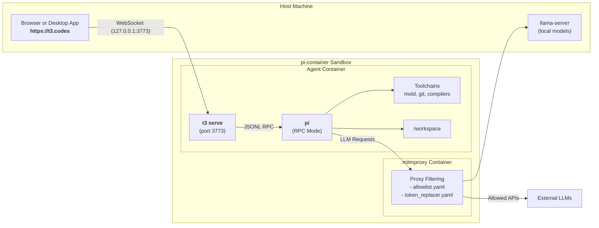

# T3 Code Integration

**T3 Code** ([t3.codes](https://t3.codes)) is an open-source, local-first control panel and graphical interface (desktop, web, and mobile) for AI coding agents. It provides a visual workspace with multi-threading, interactive diff reviews, branch management, and model reasoning visualizations.

T3 Code features first-class native support for the **Pi coding agent** (`@earendil-works/pi-coding-agent`), driving Pi via its structured JSONL RPC interface.

`pi-container` supports running T3 Code directly inside the isolated agent container, allowing you to use the **https://t3.codes** web interface (or the desktop/mobile apps) while retaining complete network egress inspection, token substitution, and sandbox isolation.

---

## Architecture Overview



### Key Principles

- **In-Container Execution**: The T3 Code server process (`t3 serve`) runs inside the agent container alongside Pi. It directly spawns `/usr/local/bin/pi` inside `/workspace`.
- **Inbound Host Forwarding**: Host port `3773` is published to the agent container (`127.0.0.1:3773`), allowing your host browser at `https://t3.codes` to establish a local WebSocket connection (`ws://127.0.0.1:3773`).
- **Proxy Egress & Token Replacement**: All outbound API calls from Pi or T3 Code traverse the `pi-coding-agent-proxy`. Unapproved network traffic is blocked, and dummy provider tokens are swapped with real credentials on the wire.
- **Dynamic Model Discovery**: T3 Code queries Pi's RPC endpoint, which dynamically loads model definitions from `/home/pi/.pi/agent/models.json` (including local `llama-server` endpoints).

---

## Quickstart

### 1. Enable the T3 Toolchain

Add `"t3"` to your `tools.include` list in `.pi-container/config.yaml`:

```yaml
tools:
  include:
    - "t3"
```

*(Alternatively, you can install the CLI dynamically in `.pi-container/dependencies/root/commands.sh` via `npm install -g t3` or `curl -fsSL https://t3.codes/install.sh | sh`).*

### 2. Launch in T3 Mode

Run the container launcher with the `--t3` flag:

```bash
./run.sh --t3
```

The launcher will:
1. Verify host port `3773` is free and forward `127.0.0.1:3773` to the agent container.
2. Launch `t3 serve --host 0.0.0.0 --port 3773`.
3. Output the T3 pairing URL:
    ```text
    ==================================================================
      Starting T3 Code server for Pi inside pi-container...
      Web UI: https://t3.codes
    ==================================================================
    Listening on http://0.0.0.0:3773
    Pairing URL: http://localhost:3773/pair#token=abcdef123456...
    ```

### 3. Connect from Your Browser

1. Click the pairing link from your terminal or open [https://t3.codes](https://t3.codes).
2. T3 Code connects to your local container instance via WebSocket.
3. Select any configured model from the model picker and start prompt sessions.

---

## Configuration Reference

### Agent Configuration (`config.yaml`)

You can set T3 mode as the default or configure custom port mappings in `.pi-container/config.yaml`:

```yaml
agent:
    # Execution mode: "cli" (default interactive terminal) or "t3" (headless server)
    mode: t3

    # Inbound host ports published directly from the agent container
    ports:
        # expose: localhost (127.0.0.1 only) or lan (0.0.0.0)
        expose: localhost
        publish:
            - 3773              # host 3773 -> container 3773
            - "13773:3773"      # custom host port 13773 -> container 3773
```

### Network Allowlist (`allowlist.yaml`)

Ensure the following upstream rule is present in `.pi-container/allowlist.yaml`:

```yaml
    - name: "t3-codes-allow"
      mode: "allow"
      hostnames:
        - "t3.codes"
        - "*.t3.codes"
        - "ping.gg"
        - "*.ping.gg"
      ip_ranges: []
```

---

## Security Considerations

1. **Loopback Binding by Default**: Host port `3773` binds strictly to `127.0.0.1`. Remote machines on your local network cannot connect unless you explicitly set `agent.ports.expose: lan`.
2. **Unchanged Sandbox Isolation**: Running T3 Code does not require relaxing SELinux confinement or enabling `nested_containers`. The server runs as the unprivileged `pi` user.
3. **Session Persistence**: Pi session trees are saved in `/home/pi/.pi/agent/sessions/`, which is mounted from your host project's `.pi-container/` directory. All thread history persists across container restarts.
